<div align="center">

<a href="https://roshnithakor07.github.io">
  
</a>

<p>
  <a href="https://roshnithakor07.github.io"></a>
  <a href="https://www.linkedin.com/in/roshnithakor07"></a>
  <a href="mailto:roshni.thakor.dev@gmail.com"></a>
  <a href="https://www.hackerrank.com/profile/roshnithakor07"></a>
  <a href="https://leetcode.com/roshnithakor07"></a>
</p>

</div>



> This profile works like my [portfolio](https://roshnithakor07.github.io): one request, traced through the systems I've built. Each section below is an endpoint.

---

### 💼 `GET /experience` &nbsp;·&nbsp; `200 OK`

| When | Role | What I shipped |
|:--|:--|:--|
| **Sep 2026 - Nov 2026** | Backend Engineer · [Shree Maruti](https://shreemaruti.com/) (via Kanhasoft) | **Smile HRMS**, a multi-tenant HR platform: Leave Management end to end, Expenses with S3 signed-URL receipts, org-scoped JWT + RBAC, **242+ unit tests** |
| **Sep 2022 - Jun 2026** | Software Developer · [Eventus Security](https://eventussecurity.com/) | SOC analytics over **hundreds of millions of records** for India's regional power grid, an AI code reviewer the team used daily, and a report engine that turned **20 hours into 1** |
| **Sep 2021 - May 2022** | Web Development Intern · [Flu Social](https://flusocial.com/) · [LetsGrowMore](https://letsgrowmore.in/) | Client sites and full-stack features alongside my degree |

---

### 🧪 `GET /projects` &nbsp;·&nbsp; `200 OK`

**At work** &nbsp;<sub>(internal products, so the code isn't public; the full stories are on my [portfolio](https://roshnithakor07.github.io/#projects))</sub>

| Project | The problem → what I built | Result |
|:--|:--|:--|
| 🔍 **DevLens** | Manual PR reviews were slow and inconsistent → AI code review on the Claude API, scoped to changed Git hunks, with **streaming** responses and NestJS-Guard RBAC | Perceived latency **~8 s → < 1 s**; used daily |
| 🛡️ **ESDL Dashboard** | Customers relied on external security tools → a real-time SOC/EDR dashboard; rewrote pagination, moved heavy work into aggregation pipelines, Redis caching, optimised ClickHouse queries | Faster, scalable dashboards over **100M+ records** |
| ⚙️ **Health Check Automation** | 16-20 hours of manual reporting → upload Excel, get 27 charts and a formatted PDF + Word report; RBAC, 2FA OTP, hardened APIs | **16-20 h → < 1 h**, fully adopted |

**On my own**

| Project | What it does | Built with | Links |
|:--|:--|:--|:--|
| 📮 **Reqway** | Postman-style API client: proxy engine, collections, environments, auth, history, code snippets | React · Express · MongoDB · JWT | [Repo](https://github.com/roshnithakor07/coderepo-react-node-postman) |
| 🎫 **Support Desk** | Ticketing with agent teams, SLA tracking and breach alerts, merge and bulk actions; **40 product rules, 132 tests** | React · Express · MongoDB · JWT | [Repo](https://github.com/roshnithakor07/coderepo-react-node-support-desk) · [Video](https://drive.google.com/file/d/1TzRcNZNis5zJPfZPnjUlP-kVZ_yzQ-8h/view) |
| 📝 **QuizCraft** | Up to 200 quiz questions from text or images in 24 languages, PDF/Word export | Next.js 14 · Groq · MongoDB | [Live](https://quizcraft-mauve.vercel.app/) · [Repo](https://github.com/roshnithakor07/quizcraft) |
| ⚡ **QuickLink** | URL shortener: Redis cache-aside (**~120 ms → ~4 ms**), sliding-window rate limits, click analytics | TypeScript · Express · MongoDB · Redis | [Repo](https://github.com/roshnithakor07/quicklink) |
| 📅 **Calendly API** | Timezone-aware availability, race-safe booking in PostgreSQL transactions, Temporal workflows for emails and Google Calendar sync | TypeScript · Express · PostgreSQL · Prisma · Temporal | [Repo](https://github.com/roshnithakor07/calendly) |
| 📊 **ComplexityIQ** | Big-O analyser for 9 languages with best/average/worst breakdown and auto-refactor | Next.js 14 · Groq · SVG | [Repo](https://github.com/roshnithakor07/complexity-iq) |
| 💸 **PayFlow** | Atomic wallet transfers with MongoDB transactions, idempotency, HMAC-signed webhooks | TypeScript · MongoDB | [Repo](https://github.com/roshnithakor07/payflow) |
| 🗄️ **FileVault** | Secure file storage with S3 presigned uploads, Redis storage quotas and RBAC | Node.js · AWS S3 · Redis | [Repo](https://github.com/roshnithakor07/FileVault) |

---

### 🏆 `GET /awards` &nbsp;·&nbsp; `200 OK`

- 🥇 **Top 3.4%** · #139 of 4,094 · HackerRank Orchestrate, Oct 2026: an AI agent pipeline that finds ghost data left behind after deletion · [leaderboard](https://www.hackerrank.com/contests/hackerrank-orchestrate-october26/challenges/ghost-data-still-exists/leaderboard?username=roshnithakor07)
- 🥈 **Top 18.5%** · #367 of 1,983 · HackerRank Orchestrate, Aug 2026: a multimodal notification router on the Claude API (text, images, voice notes → notify / digest / mute) · [leaderboard](https://www.hackerrank.com/contests/hackerrank-orchestrate-august26/challenges/message-notification-router/leaderboard?username=roshnithakor07)
- 🥉 **Top 26%** · #460 of 1,773 · HackerRank Orchestrate, Jun 2026: multimodal insurance-claim verification with vision-language models · [repo](https://github.com/roshnithakor07/multimodal-damage-claim-verification)
- 🎓 **B.E. Information Technology** · Saffrony Institute of Technology (GTU) · CGPA 9.0 / 10

---

### 🧰 `GET /stack` &nbsp;·&nbsp; `200 OK`

<p align="center">
  <br/>
  <br/><br/>
  
  
  
  
  
  
  
</p>

---

### 📊 `GET /stats` &nbsp;·&nbsp; `200 OK`

<p align="center">
  
</p>

<details>
<summary><b>☕ <code>GET /beyond-code</code></b></summary>

```yaml
currently_learning: [System Design, Advanced DSA, Docker & DevOps]
beyond_code:
  - 🎨 Painting & sketching
  - 🧘 Yoga & strength training every morning
  - 🌿 Spending time in nature
```

</details>

<div align="center">
<sub>Same notebook, same trace as my <a href="https://roshnithakor07.github.io">portfolio</a>. Say hi: <a href="mailto:roshni.thakor.dev@gmail.com">roshni.thakor.dev@gmail.com</a></sub><br/>

</div>
